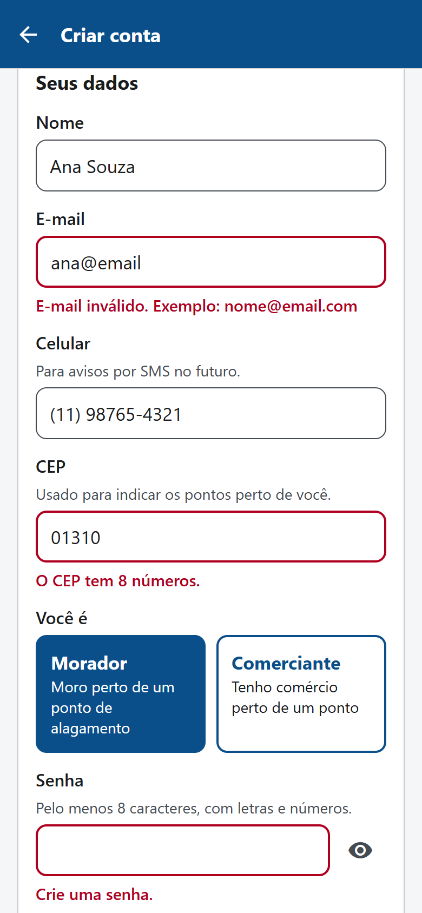
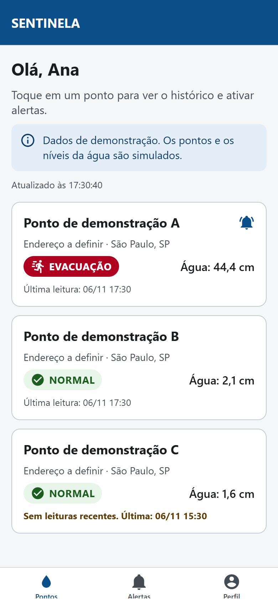
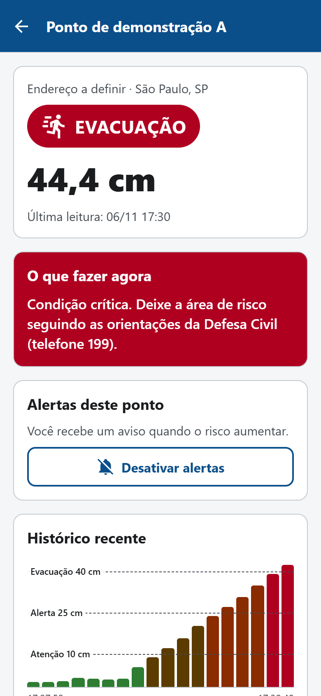
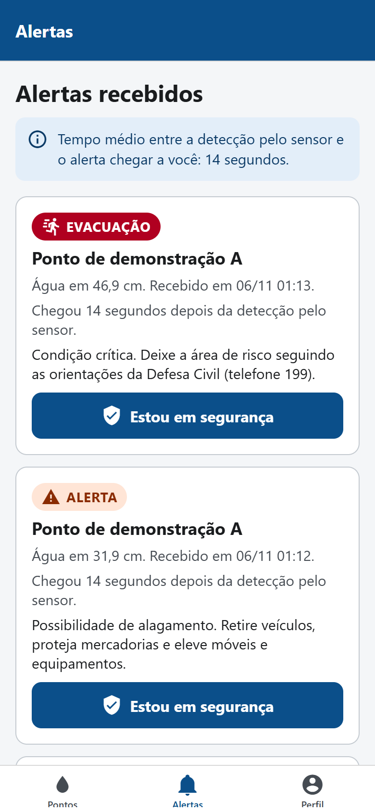
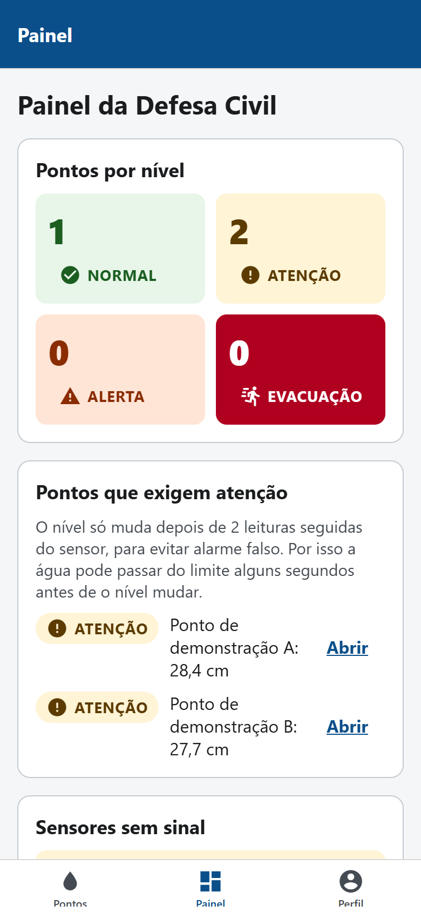
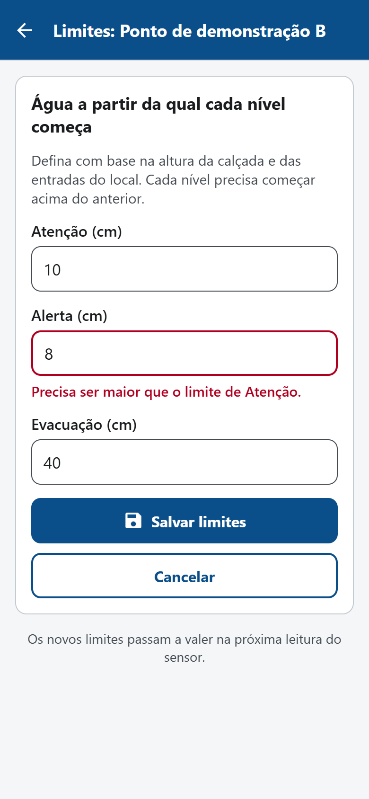
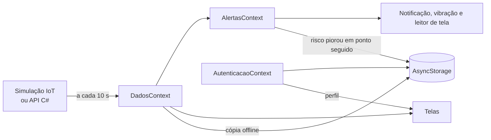

# SENTINELA: app do cidadão e do agente

[](https://github.com/vitordpacifico/sentinela-mobile/actions/workflows/ci.yml)

Entrega de **Mobile Development & IoT** da Global Solution 2026.2 (FIAP, Engenharia de Software, 3º ano).

Aplicativo em React Native (Expo) para moradores e comerciantes acompanharem o risco de alagamento e receberem um alerta antes que a água chegue, e para agentes da Defesa Civil acompanharem todos os pontos monitorados.

## Ficha da CitizenTech

| Item | Resposta |
|---|---|
| Nome | SENTINELA |
| Cidade e bairro | São Paulo, SP. **Bairro e ponto a definir.** |
| Problema | Em vários pontos de São Paulo, moradores e comerciantes só percebem o alagamento quando a água já está chegando às ruas, garagens e lojas. Falta informação antecipada para se prepararem. |
| Público beneficiado | Moradores e comerciantes de regiões com histórico de alagamento. Também a Defesa Civil e órgãos públicos que monitoram pontos críticos. |
| Como funciona | Um sensor ultrassônico ligado a um ESP32 mede o nível da água. O dispositivo aciona LED e sirene no local, mesmo sem internet, e envia as leituras para uma API em C#, que classifica o risco. O app avisa quem acompanha aquele ponto. |
| O que cada parte faz | **ESP32:** mede e aciona o alerta local. **API:** registra as leituras e classifica o risco. **App:** mostra o risco, avisa o cidadão e dá ao agente a visão de todos os pontos. **Dashboard:** acompanhamento administrativo. |
| Link do repositório | https://github.com/vitordpacifico/sentinela-mobile |
| ODS conectados | ODS 3 (Saúde e Bem-Estar), ODS 11 (Cidades e Comunidades Sustentáveis) e ODS 13 (Ação Contra a Mudança Global do Clima) |

### Hipóteses

Ainda precisam ser validadas com quem vive o problema e com testes do protótipo.

1. Avisados antes, moradores e comerciantes conseguem retirar veículos, proteger mercadorias e sair da área de risco. A meta do grupo é avisar com cerca de 20 minutos de antecedência.
2. Um alerta no celular chega antes de a pessoa perceber a água subindo.
3. Exigir duas leituras seguidas acima do limite reduz os alarmes falsos sem atrasar muito o aviso.
4. O alerta local, com sirene e LED, protege quem está sem internet ou sem o app.

### Indicadores

| Indicador | Como o app mede |
|---|---|
| **Principal:** minutos entre a detecção da condição crítica pelo sensor e o recebimento do alerta pelo morador | Cada alerta guarda o horário da detecção e o da chegada. A aba Alertas mostra o tempo de cada um e a média. |
| Alertas emitidos | Histórico na aba Alertas |
| Pontos monitorados e pontos por nível | Painel do agente |
| Disponibilidade do dispositivo | Painel do agente e aviso de "sem leituras recentes" em cada ponto |

**Grupo:**

| Nome | RM |
|---|---|
| Victor Pacifico Dias | 558017 |
| Eduardo | A preencher |
| Guilherme | A preencher |
| Gustavo | A preencher |
| Heloísa | A preencher |

**Vídeo (até 3 min):** link a preencher. O roteiro está em [docs/ROTEIRO_VIDEO.md](docs/ROTEIRO_VIDEO.md).

## Como instalar e rodar

Requisitos:

- Node.js LTS no computador.
- O app **Expo Go** atualizado no celular. Este projeto usa o Expo SDK 58.

No terminal, dentro da pasta do projeto:

```bash
npm install
```

```bash
npx expo start
```

Leia o QR code com o Expo Go (Android) ou com a câmera (iPhone). O celular e o computador precisam estar na mesma rede Wi-Fi. Se não estiverem, use `npx expo start --tunnel`.

### Contas de demonstração

Criadas automaticamente no primeiro uso. Na tela de login, os botões "Usar conta de cidadão" e "Usar conta de agente" preenchem os dados.

| Perfil | E-mail | Senha |
|---|---|---|
| Cidadão | `cidadao@sentinela.demo` | `Cidadao123` |
| Agente da Defesa Civil | `agente@sentinela.demo` | `Agente123` |

Também é possível criar uma conta de cidadão em **Criar conta**. Agentes não se cadastram pelo app: o acesso seria criado pelo órgão.

### Avaliar em 5 minutos

1. Entre como **cidadão**, abra o **Ponto de demonstração A** e toque em **Ativar alertas**.
2. Em cerca de 1 minuto, a água simulada sobe e o app avisa a cada nível: Atenção, Alerta e Evacuação.
3. Na aba **Alertas**, veja o tempo entre a detecção e o aviso, e toque em **Estou em segurança**.
4. Saia e entre como **agente**. O **Painel** mostra os pontos por nível e os sensores sem sinal.
5. No Painel, toque em **Simular chuva em Ponto de demonstração B**.
6. Abra um ponto e toque em **Ajustar limites** para mudar os centímetros de cada nível.

## Telas

> Prints gerados pela versão web do app, em tamanho de celular e com dados de demonstração. Serão substituídos por prints do app rodando no Expo Go.

| Entrar | Criar conta | Pontos | Ponto |
|---|---|---|---|
|  |  |  |  |

| Alertas | Painel do agente | Ajustar limites | Perfil |
|---|---|---|---|
|  |  |  |  |

| Tela | Perfil | O que faz |
|---|---|---|
| **Entrar** | Todos | Login com e-mail e senha, com validação. Bloqueia por 30 s depois de 5 senhas erradas. |
| **Criar conta** | Visitante | Cadastro do cidadão com máscaras de celular e CEP, validação de cada campo e consentimento |
| **Pontos** | Todos | Pontos monitorados, com os de maior risco primeiro. Funciona sem conexão, com a última cópia salva. |
| **Ponto** | Todos | Nível da água, risco, o que fazer, gráfico e limites. O cidadão ativa alertas, e o agente ajusta os limites. |
| **Alertas** | Cidadão | Alertas recebidos, tempo até a chegada e "Estou em segurança". A aba mostra quantos faltam confirmar. |
| **Painel** | Agente | Pontos por nível, pontos que exigem atenção (com a explicação da regra das 2 leituras), sensores sem sinal e controle da simulação IoT |
| **Ajustar limites** | Agente | Formulário com máscara de centímetros e validação de ordem entre os níveis |
| **Perfil** | Todos | O cidadão edita os dados (com as mesmas máscaras), gerencia notificações e pontos seguidos e pode excluir a conta, confirmando com a senha. Todos podem sair. |

## Como o app atende a avaliação

| Critério | Como o app atende |
|---|---|
| **Telas e navegação** | Expo Router com 8 telas. Rotas protegidas por login (`Stack.Protected`) e por perfil: o cidadão vê a aba Alertas, e o agente vê o Painel e o ajuste de limites. A notificação abre o ponto que gerou o alerta. |
| **Consumo de dados (mock ou simulação IoT)** | `src/servicos/dados/simulacao.ts` imita um ESP32 com sensor ultrassônico: mede a distância até a água a cada 10 s, com ruído, e calcula o nível. A simulação gera alertas, notificações e vibração. O agente pode provocar uma chuva forte em qualquer ponto. O cliente da API real (`api.ts`) segue o mesmo contrato, com validação de cada resposta. |
| **Persistência (AsyncStorage)** | Camada de serviço em `src/servicos/armazenamento/`: contas, sessão, pontos seguidos, alertas, cópia offline dos pontos, limites ajustados e chuvas simuladas, que continuam depois de fechar o app. Só `armazenamento.ts` acessa o AsyncStorage diretamente. O telefone e o CEP não vão para o AsyncStorage: ficam no cofre do sistema (`cofre.ts`, veja Segurança). |
| **Acessibilidade** | Veja a seção abaixo |
| **Aderência ao problema** | Avisa quando o risco piora e diz o que fazer em cada nível. Mede o indicador de impacto do grupo e avisa quando o sensor para de enviar dados. Dá ao agente a visão de todos os pontos. |
| **Documentação** | Este README, o contrato da API ([docs/API.md](docs/API.md)), o roteiro do vídeo e o `prompts.md` |

## Arquitetura

O código fica separado em camadas, e cada tela e componente tem o arquivo de estilos à parte (`estilos.ts`).

```text
src/
  app/                 Rotas do Expo Router. Cada arquivo só aponta para uma tela.
  telas/               Telas: index.tsx (lógica e layout) + estilos.ts
  componentes/         Componentes reutilizáveis: index.tsx + estilos.ts
  contexto/            Context API: autenticação, dados dos pontos e alertas
  servicos/
    armazenamento/     AsyncStorage: contas, sessão, alertas, pontos seguidos, cópia offline;
                       cofre do sistema (SecureStore) para telefone e CEP
    dados/             Simulação IoT, cliente da API e escolha da fonte
    alertas/           Monitor de risco e notificações
    seguranca/         Hash das senhas
  dominio/             Tipos e regras: níveis de risco, sensor, perfis
  utilitarios/         Máscaras, validações e formatação
  estilos/             Tema (cores, espaçamentos) e estilos comuns
```



### Contextos (Context API)

| Contexto | Responsabilidade |
|---|---|
| `AutenticacaoContext` | Usuário logado, entrar, cadastrar, atualizar e sair. A sessão continua depois de fechar o app. |
| `DadosContext` | Consulta os pontos a cada 10 s e mostra a cópia salva quando não há conexão |
| `AlertasContext` | Para o cidadão, cria os alertas quando o risco de um ponto seguido piora e conta os pendentes |

### Regra de risco

| Nível | Água a partir de (exemplo) | Orientação |
|---|---:|---|
| Normal | 0 cm | Nenhuma ação |
| Atenção | 10 cm | Acompanhar as atualizações |
| Alerta | 25 cm | Retirar veículos, proteger mercadorias, elevar objetos |
| Evacuação | 40 cm | Deixar a área seguindo a Defesa Civil (199) |

- Os limites são exemplos. O agente pode ajustá-los para cada ponto.
- O risco só muda depois de **duas leituras seguidas** no novo nível, para evitar alarme falso. Na solução final, essa regra fica na API.
- Só dados recém-consultados geram alerta. A cópia offline pode estar velha e nunca dispara aviso.

### Formulários: máscaras e validações

| Campo | Máscara | Validação |
|---|---|---|
| Nome | | De 2 a 60 caracteres, só letras |
| E-mail | | Formato `nome@dominio.com`, único entre as contas |
| Celular | `(11) 91234-5678` | DDD válido; 10 dígitos para fixo ou 11 com 9 inicial para celular |
| CEP | `01001-000` | 8 dígitos, não pode ser só zeros |
| Senha | | Pelo menos 8 caracteres, com letras e números; confirmação igual |
| Limites (agente) | `12,5` | De 1 a 300 cm; cada nível acima do anterior |

### Segurança

- A senha nunca é salva em texto. O app guarda um sal aleatório e o hash SHA-256 de sal + senha.
- A comparação do hash leva o mesmo tempo, encontre ou não uma diferença.
- O login bloqueia por 30 segundos depois de 5 senhas erradas seguidas.
- O telefone e o CEP ficam no cofre do sistema (`expo-secure-store`: Keychain no iOS, Keystore no Android), criptografados e presos ao aparelho. O AsyncStorage, que guarda em texto aberto, fica só com nome, e-mail, perfil e o hash da senha. Contas salvas antes do cofre têm esses dados movidos para ele na abertura do app. A versão web, usada só nos prints, não tem cofre e guarda no armazenamento do navegador.
- A exclusão de conta pede a senha de novo e apaga a conta, o telefone e o CEP do cofre, os pontos acompanhados e os alertas do celular, atendendo ao direito de eliminação dos dados da LGPD.
- **Limite conhecido:** o login é local porque a API ainda não existe. Em produção, a autenticação ficaria no servidor, com bcrypt ou Argon2.

### Notificações

O app usa notificações locais: consulta os dados a cada 10 segundos e avisa sozinho quando o risco de um ponto acompanhado piora.

Notificações enviadas pelo servidor (push) não funcionam no Expo Go para Android desde o SDK 53. Por isso, nesta versão, os alertas só chegam com o app aberto. Ao voltar para o app, ele consulta os dados na hora.

## Acessibilidade

- O risco é sempre mostrado com ícone, texto e cor, nunca só com a cor.
- Todos os pares de texto e fundo têm contraste de pelo menos 6,9:1, acima do mínimo de 4,5:1 da WCAG AA.
- Todos os botões têm pelo menos 48 pontos de área de toque e descrição para o leitor de tela.
- Todo campo tem rótulo visível. O erro de validação aparece abaixo do campo e é anunciado pelo leitor de tela.
- As opções funcionam como botões de opção (`radio`), e o consentimento como caixa de seleção (`checkbox`).
- O botão de mostrar ou esconder a senha tem descrição para o leitor de tela.
- O leitor de tela anuncia um alerta novo em qualquer tela, e a aba Alertas informa quantos faltam confirmar.
- O gráfico é lido como um resumo em texto.
- O texto acompanha o tamanho de fonte do celular, e os cartões quebram a linha em vez de cortar o texto.
- O celular vibra em um alerta novo, com uma vibração diferente na Evacuação.

## Verificações

```bash
npm test
```

```bash
npm run typecheck
```

```bash
npm run lint
```

São 134 testes automatizados, divididos em duas camadas:

- **Lógica:** máscaras, validações, contas e senhas, exclusão de conta, armazenamento, regra de risco, simulação IoT, cliente da API e criação de alertas.
- **Telas** (React Native Testing Library): login com bloqueio por tentativas, cadastro com máscaras e erros, ajuste de limites, painel do agente e exclusão de conta.

## Dados

- Os pontos, endereços e níveis da água são simulados e aparecem marcados como "dados de demonstração" no app.
- Nenhum dado pessoal real é usado.
- Os dados ficam somente no celular, e o cidadão pode excluí-los pelo Perfil.
- O SENTINELA não substitui as orientações oficiais da Defesa Civil.
