# Pluvia: alagamentos perto de você

[](https://github.com/vitordpacifico/pluvia-mobile/actions/workflows/ci.yml)

Entrega de **Mobile Development & IoT** da Global Solution 2026.2 (FIAP, Engenharia de Software, 3º ano), tema CitizenTech.

O Pluvia é um app em React Native (Expo) que:

- mostra alagamentos perto da pessoa, com a fonte e o horário de cada informação;
- avisa quando surge um alagamento perto do carro estacionado ou de um lugar favorito, e quando a ocorrência é encerrada;
- recebe relatos com foto da comunidade, triados por IA e conferidos pela equipe antes de aparecer no mapa.

A solução segue o documento de definição do grupo, que chama a proposta de **Alaga**. **Pluvia** é o nome e a marca do app.

## Ficha da CitizenTech

| Item | Resposta |
|---|---|
| Nome | Pluvia |
| Cidade e bairro | São Paulo, SP. O protótipo usa uma região do Centro e da Zona Sudeste com histórico de alagamentos: Cambuci, Ipiranga, Mooca, Vila Prudente e bairros vizinhos. |
| Cidadão beneficiado | Motoristas, motociclistas, entregadores, trabalhadores que estacionam na rua, passageiros e moradores de áreas que alagam |
| Problema, em uma frase | Durante chuvas fortes, as pessoas entram em ruas alagadas sem aviso, deixam o carro em lugares que alagam e não sabem se um alagamento continua ativo, porque a informação está espalhada e sem contexto. |
| Como funciona | O app reúne ocorrências de fontes identificadas (dados oficiais, sensores de nível e relatos da comunidade) e mostra no mapa o que acontece por perto. A pessoa salva onde estacionou e os lugares que importam, e recebe aviso de alagamento novo, de risco elevado e de encerramento. Relatos com foto passam por uma triagem de IA e por uma equipe antes de serem publicados. |
| O que cada parte faz | **App (este repositório):** mapa, filtros, meu carro, relatos com foto, avisos e moderação. **ESP32 (Physical Computing):** mede o nível da água e registra o alagamento. **API em C# (C# e SOA):** recebe ocorrências, sensores e relatos. **IA e ML:** triagem das fotos e estimativa de risco por região. **Linux (Operating Systems):** roda a API com monitoramento. **Cybersecurity:** audita os dados pessoais do app. |
| Link do repositório | https://github.com/vitordpacifico/pluvia-mobile |
| Indicador de impacto | **Rapidez dos avisos:** tempo entre o registro de um alagamento e a chegada do aviso ao celular. Também: confiabilidade (ocorrências com fonte e horário identificados). |
| ODS conectados | ODS 11 (Cidades e Comunidades Sustentáveis), ODS 13 (Ação Contra a Mudança Global do Clima) e ODS 9 (Indústria, Inovação e Infraestrutura) |

### Hipóteses

Ainda precisam ser validadas em testes com pessoas do público-alvo.

1. Um aviso no lugar e na hora certos ("alagou perto do seu carro") ajuda a pessoa a decidir antes de sair ou de estacionar.
2. Mostrar a fonte, o horário e o status de cada ocorrência evita confundir um alagamento antigo com um atual.
3. Relatos com foto da comunidade preenchem lugares sem sensor nem dado oficial, desde que passem por triagem e conferência.
4. Avisar que "sem dados" não significa "seguro" reduz decisões arriscadas.

### Indicadores

| Indicador | Como o app mede |
|---|---|
| **Principal:** rapidez dos avisos | Cada aviso guarda o horário do registro do alagamento e o da chegada. A aba Avisos mostra o tempo de cada um e a média. |
| Confiabilidade da informação | Toda ocorrência mostra a fonte, o horário de registro, a última atualização e o histórico de status |
| Relatos da comunidade | O painel da equipe conta os relatos em análise, e cada relato mostra a triagem e a decisão |
| Disponibilidade dos sensores | O painel avisa os sensores sem leitura recente |
| Utilidade para o usuário | A medir em teste de usabilidade: a pessoa acha os eventos e entende o status sem ajuda? |

**Grupo:**

| Nome | RM |
|---|---|
| Victor Pacifico Dias | 558017 |
| Guilherme Abe | 554743 |
| Gustavo Ruiz Vieira Paulino | 554779 |
| Eduardo | A preencher |
| Heloísa | A preencher |

**Vídeo (até 3 min):** link a preencher. O roteiro está em [docs/ROTEIRO_VIDEO.md](docs/ROTEIRO_VIDEO.md).

## Como instalar e rodar

Requisitos:

- Node.js LTS no computador.
- O app **Expo Go** atualizado no celular. Este projeto usa o Expo SDK 58.

No terminal, dentro da pasta do projeto:

```bash
npm install
```

```bash
npx expo start
```

Leia o QR code com o Expo Go (Android) ou com a câmera (iPhone). O celular e o computador precisam estar na mesma rede Wi-Fi. Se não estiverem, use `npx expo start --tunnel`.

### Rodar no navegador do computador

```bash
npx expo start --web
```

O app abre no navegador em tamanho de celular, centralizado na tela. Na web:

- o mapa usa o OpenStreetMap, com os mesmos pinos, raios e áreas de risco do celular;
- os avisos chegam como notificações do navegador (permita quando o navegador perguntar);
- a câmera abre a escolha de arquivo do computador;
- o carro, os favoritos, o telefone e o CEP ficam no armazenamento do navegador, porque a web não tem o cofre do sistema.

### Contas de demonstração

Criadas automaticamente no primeiro uso. Na tela de login, os botões "Usar conta de cidadão" e "Usar conta da equipe" preenchem os dados.

| Perfil | E-mail | Senha |
|---|---|---|
| Cidadão (já com um carro salvo no Cambuci) | `cidadao@pluvia.demo` | `Cidadao123` |
| Equipe de monitoramento | `agente@pluvia.demo` | `Agente123` |

Também é possível criar uma conta de cidadão em **Criar conta**. A equipe não se cadastra pelo app: o acesso é criado pela coordenação.

### Avaliar em 5 minutos

1. Entre como **cidadão**. O **Mapa** mostra as ocorrências perto do carro, com a legenda dos status e as ruas com risco estimado.
2. Abra uma ocorrência: fonte, horário, histórico e o aviso de que encerrada não significa liberada.
3. Na aba **Meu carro**, veja a situação no raio do carro e consulte um bairro em **Onde estacionar?**.
4. Deixe o app aberto. A chuva simulada no sensor de demonstração 1 começa quando o app abre e se repete a cada 6 minutos: primeiro o app avisa o risco estimado elevado, depois o alagamento perto do carro e, uns 4 minutos depois, o encerramento. Veja tudo na aba **Avisos**.
5. Na aba **Relatar**, envie um relato com foto. A tela seguinte mostra a triagem da IA e o status "Em análise".
6. Saia e entre como **equipe**. Em **Moderação**, abra o relato, confira o contexto e publique. Ele aparece no mapa como relato comunitário.
7. No **Painel**, simule chuva no sensor 2, ou abra uma ocorrência oficial e marque como encerrada para ver o aviso de encerramento.

## Telas

> Prints gerados pela versão web do app, em tamanho de celular e com dados de demonstração.

| Entrar | Mapa | Ocorrência | Meu carro |
|---|---|---|---|
| 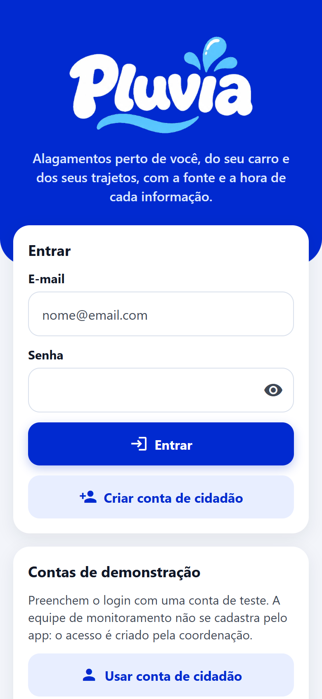 | 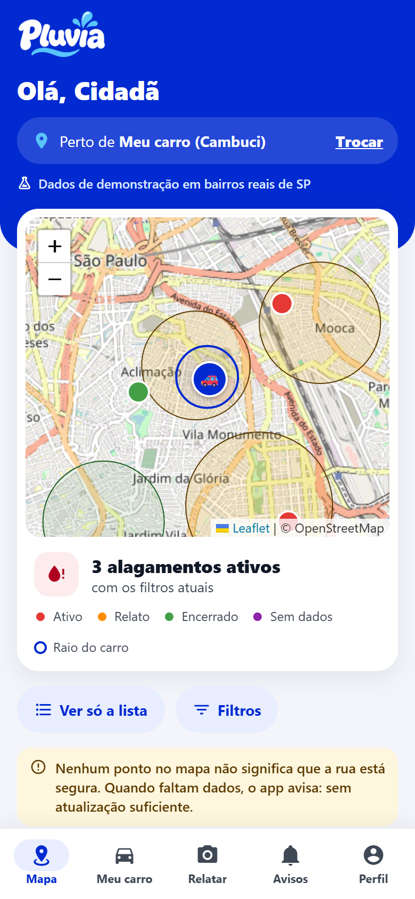 | 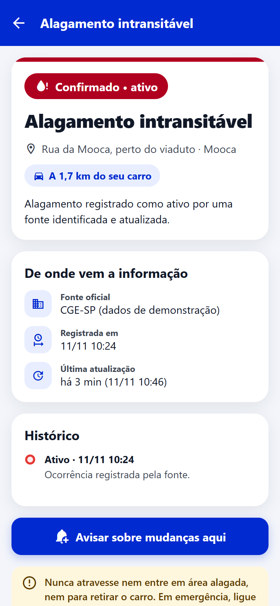 | 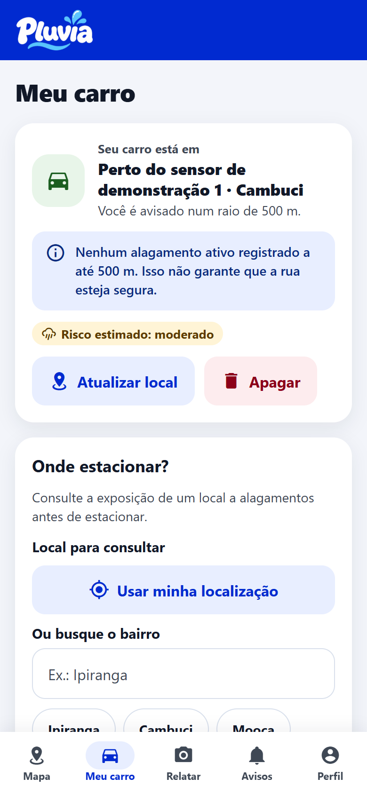 |

| Relatar | Resultado da IA | Avisos | Perfil |
|---|---|---|---|
| 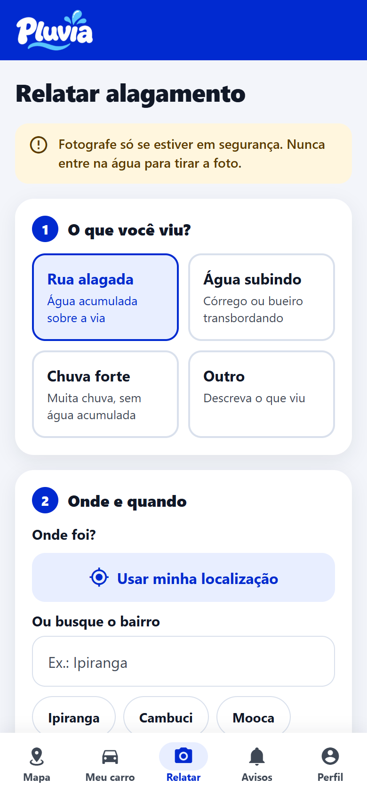 | 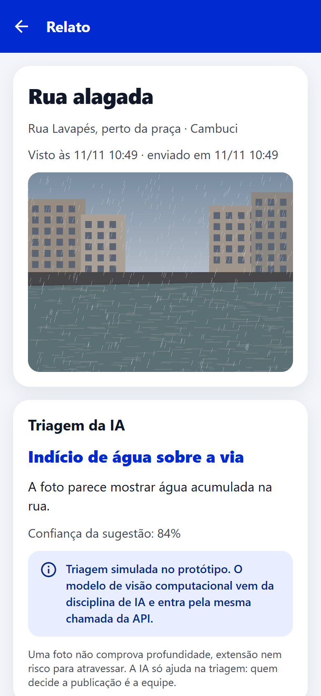 | 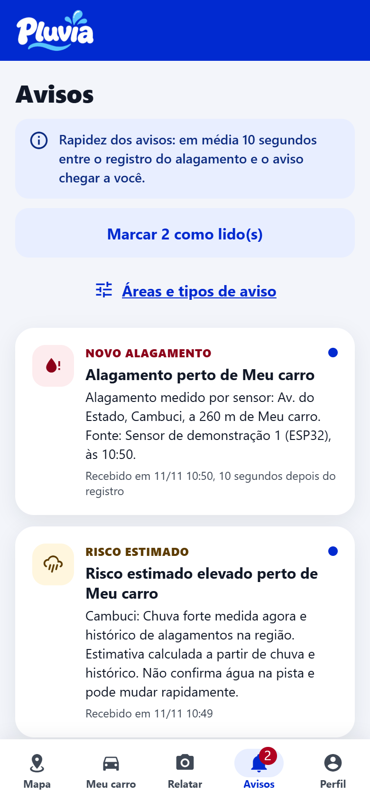 | 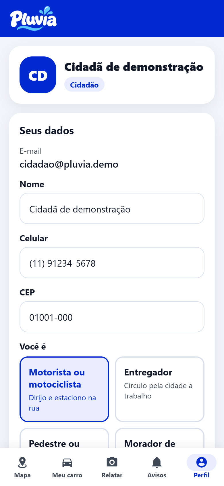 |

| Moderação | Checagem do contexto | Painel da equipe |
|---|---|---|
|  | 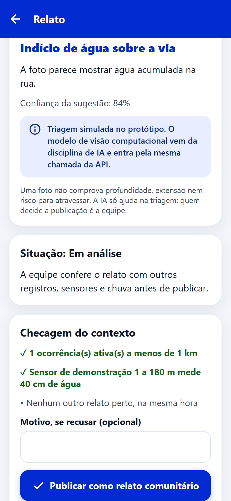 | 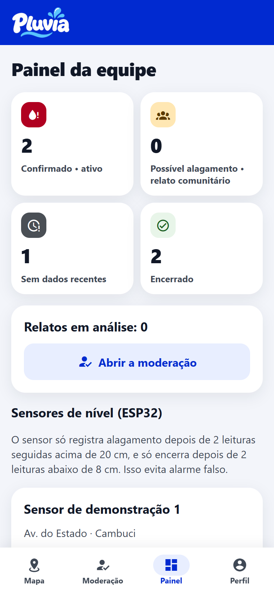 |

| Tela | Perfil | O que faz |
|---|---|---|
| **Entrar** | Todos | Login com e-mail e senha, com validação. Bloqueia por 30 s depois de 5 senhas erradas. |
| **Criar conta** | Visitante | Cadastro do cidadão com máscaras de celular e CEP, validação de cada campo e consentimento |
| **Mapa** | Todos | Mapa e lista das ocorrências perto do carro ou de um bairro, com filtros de situação, fonte, período e distância. Mostra as ruas com risco estimado e funciona sem conexão, com a última cópia salva. |
| **Ocorrência** | Todos | Status, fonte, horários, histórico e, se vier de sensor, o gráfico das leituras. O cidadão pode ser avisado de mudanças ali. A equipe pode marcar como encerrada. |
| **Meu carro** | Cidadão | Salva onde o carro está (GPS ou bairro, com máscara de raio), mostra os alagamentos no raio e o risco estimado. Tem a consulta **Onde estacionar?**. |
| **Relatar** | Cidadão | Formulário com tipo, local, referência, hora (com máscara), descrição e foto opcional. Lista os relatos enviados. |
| **Relato** | Todos | Resultado da triagem da IA, status do relato e exclusão pelo autor. Para a equipe, checagem de contexto e publicação. |
| **Avisos** | Cidadão | Avisos recebidos e tempo médio até chegarem |
| **Áreas monitoradas** | Cidadão | Locais favoritos, raio, tipos de aviso e opção de silenciar |
| **Moderação** | Equipe | Relatos em análise com a sugestão da IA |
| **Painel** | Equipe | Ocorrências por situação, sensores com gráfico e simulação de chuva |
| **Perfil** | Todos | Dados do cidadão (com as mesmas máscaras), notificações, áreas monitoradas, sair e excluir a conta |

## Como o app atende a avaliação

| Critério | Como o app atende |
|---|---|
| **Telas e navegação** | Expo Router com 12 telas. Rotas protegidas por login (`Stack.Protected`) e por perfil (`Tabs.Protected`): o cidadão vê Meu carro, Relatar e Avisos, e a equipe vê Moderação e Painel. A notificação abre a ocorrência que gerou o aviso. |
| **Consumo de dados (mock ou simulação IoT)** | `src/servicos/dados/simulacao.ts` imita três ESP32 com sensor ultrassônico (um deles sem sinal), uma fonte oficial com ocorrências ativas, encerradas e sem atualização, o risco estimado por região e o servidor dos relatos. As leituras do sensor geram ocorrências, avisos, notificações e vibração. O cliente da API real (`api.ts`) segue o contrato de [docs/API.md](docs/API.md), com validação de cada resposta. |
| **Persistência (AsyncStorage)** | Camada de serviço em `src/servicos/armazenamento/`: contas, sessão, avisos, preferências, cópia offline do mapa e estado da simulação. Só `armazenamento.ts` acessa o AsyncStorage diretamente. Os dados pessoais (telefone, CEP, local do carro e favoritos) ficam no cofre do sistema (veja Segurança). |
| **Acessibilidade** | Veja a seção abaixo |
| **Aderência ao problema** | Segue o MVP do documento de definição: mapa com status, meu carro com aviso, relato com foto e triagem de IA, e aviso de encerramento. Diferencia os cinco estados do documento e nunca trata "sem dados" como "seguro". |
| **Documentação** | Este README, o contrato da API ([docs/API.md](docs/API.md)), o roteiro do vídeo e o `prompts.md` |

## Arquitetura

O código fica separado em camadas, e cada tela e componente tem o arquivo de estilos à parte (`estilos.ts`).

```text
src/
  app/                 Rotas do Expo Router. Cada arquivo só aponta para uma tela.
  telas/               Telas: index.tsx (lógica e layout) + estilos.ts
  componentes/         Componentes reutilizáveis: index.tsx + estilos.ts
                       (o Mapa tem uma versão para web, que mostra a lista)
  contexto/            Context API: autenticação, dados do mapa, locais e avisos
  servicos/
    armazenamento/     AsyncStorage (contas, sessão, avisos, cópia offline)
                       e cofre do sistema (telefone, CEP, carro e favoritos)
    dados/             Simulação IoT, cliente da API e escolha da fonte
    alertas/           Monitor de avisos e notificações
    dispositivo/       Localização e fotos (com limpeza dos metadados)
    ia/                Triagem simulada das fotos
    seguranca/         Hash das senhas
  dominio/             Tipos e regras: ocorrências, status, distância, filtros, avisos, relatos
  utilitarios/         Máscaras, validações e formatação
  estilos/             Tema (cores da marca, espaçamentos) e estilos comuns
```

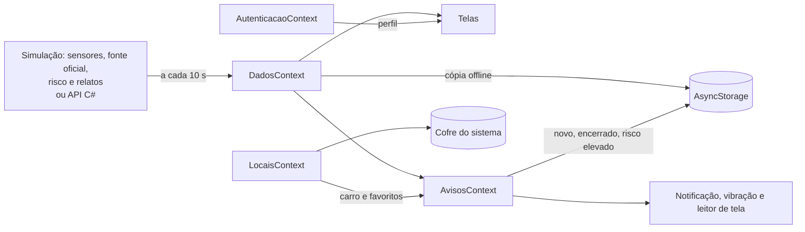

### Contextos (Context API)

| Contexto | Responsabilidade |
|---|---|
| `AutenticacaoContext` | Usuário logado, entrar, cadastrar, atualizar, sair e excluir a conta. A sessão continua depois de fechar o app. |
| `DadosContext` | Consulta ocorrências, riscos e sensores a cada 10 s e mostra a cópia salva quando não há conexão |
| `LocaisContext` | Carro e locais favoritos do cidadão, guardados no cofre |
| `AvisosContext` | Compara cada consulta com a anterior e cria os avisos perto dos locais do cidadão |

### Status das ocorrências

Os mesmos cinco estados do documento de definição, sempre com ícone, texto e cor:

| Estado | Quando aparece |
|---|---|
| Confirmado • ativo | Fonte oficial ou sensor registrou o alagamento e atualizou na última hora |
| Possível alagamento • relato comunitário | Relato de morador conferido e publicado pela equipe. Nunca aparece como oficial. |
| Encerrado | A fonte marcou o fim. O app diz "encerrada às HH:MM" e avisa que isso não garante que a via esteja liberada. |
| Relato em análise | Relato enviado e ainda não conferido. Só o autor e a equipe veem. |
| Sem dados recentes | Ocorrência ativa sem atualização há mais de 1 hora. O app avisa que falta de dados não é sinal de segurança. |

O **risco estimado** (baixo, moderado ou elevado) aparece separado das ocorrências, sempre com a mensagem de incerteza.

### Regras dos avisos

- O cidadão escolhe o raio de cada local (300 m, 500 m, 1 km ou 2 km) e os tipos de aviso: alagamento novo, encerramento e risco elevado.
- Só mudanças geram aviso. A mesma ocorrência nunca gera dois avisos do mesmo tipo.
- Na primeira consulta, o app registra o que já existe sem avisar, para não disparar avisos antigos.
- Silenciar desliga as notificações, mas os avisos continuam na aba Avisos.
- O sensor só registra alagamento depois de **2 leituras seguidas** acima de 20 cm, e só encerra depois de 2 leituras abaixo de 8 cm. Isso evita alarme falso.
- Só dados recém-consultados geram aviso. A cópia offline pode estar velha e nunca dispara aviso.

### Formulários: máscaras e validações

| Campo | Máscara | Validação |
|---|---|---|
| Nome | | De 2 a 60 caracteres, só letras |
| E-mail | | Formato `nome@dominio.com`, único entre as contas |
| Celular | `(11) 91234-5678` | DDD válido; 10 dígitos para fixo ou 11 com 9 inicial para celular |
| CEP | `01001-000` | 8 dígitos, não pode ser só zeros |
| Senha | | Pelo menos 8 caracteres, com letras e números; confirmação igual |
| Local (carro, favorito, relato) | | GPS ou bairro escolhido; rua ou referência de 3 a 80 caracteres |
| Hora do relato | `14:30` | Hora válida, nas últimas 6 horas; uma hora maior que a atual conta como de ontem |
| Descrição do relato | | Até 200 caracteres; obrigatória quando o tipo é "Outro" |
| Foto do relato | | Exige confirmar que a foto é atual e do local indicado |
| Envio do relato | | Exige confirmar que a pessoa está em lugar seguro |
| Nome do local favorito | | De 2 a 30 caracteres |

### Segurança e privacidade

- A senha nunca é salva em texto. O app guarda um sal aleatório e o hash SHA-256 de sal + senha.
- A comparação do hash leva o mesmo tempo, encontre ou não uma diferença.
- O login bloqueia por 30 segundos depois de 5 senhas erradas seguidas.
- **Cofre do sistema:** telefone, CEP, local do carro e locais favoritos ficam no `expo-secure-store` (Keychain no iOS, Keystore no Android), criptografados e presos ao aparelho. O AsyncStorage, que guarda em texto aberto, fica só com nome, e-mail, perfil e o hash da senha. O local do carro é visível só para o próprio usuário.
- **Fotos protegidas:** antes do envio, o app gera uma nova imagem com `expo-image-manipulator`, sem os metadados (EXIF), incluindo a localização da câmera. O formulário pede para não escrever placas nem nomes.
- **Localização por escolha:** o GPS só é pedido quando a pessoa toca em "Usar minha localização". Tudo funciona escolhendo o bairro.
- **LGPD:** o autor pode excluir um relato, e a exclusão de conta pede a senha e apaga a conta, o cofre, os avisos e os relatos da pessoa.
- **Comunicação de emergência:** o app nunca diz que uma rua está liberada e lembra de não atravessar água, com os telefones 199 e 193.
- **Limite conhecido:** o login é local porque a API ainda não existe. Em produção, a autenticação ficaria no servidor, com bcrypt ou Argon2. A versão web, usada só nos prints, não tem cofre e guarda no armazenamento do navegador.

### Inteligência artificial

- **Triagem das fotos:** no protótipo, a triagem é simulada a partir do tipo do relato, e a tela diz isso. O modelo de visão computacional vem da disciplina de IA e entra pelo endpoint `POST /fotos/analise`, sem mudar o app.
- **Risco estimado:** no protótipo, sobe para elevado quando o sensor da região mede água. O modelo de ML treinado com dados públicos vem da disciplina de IA, pelo endpoint `GET /riscos`.
- A IA só sugere. Quem decide a publicação de um relato é a equipe.

### Notificações

O app usa notificações locais: consulta os dados a cada 10 segundos e avisa sozinho quando algo muda perto de um local do cidadão. Na versão web, usa as notificações do navegador.

Notificações enviadas pelo servidor (push) não funcionam no Expo Go para Android desde o SDK 53. Por isso, nesta versão, os avisos só chegam com o app aberto. Ao voltar para o app, ele consulta os dados na hora.

## Acessibilidade

- O status é sempre mostrado com ícone, texto e cor, nunca só com a cor.
- O mapa tem uma lista alternativa com a mesma informação, e é possível esconder o mapa.
- Todos os pares de texto e fundo têm contraste de pelo menos 7:1, acima do mínimo de 4,5:1 da WCAG AA.
- Todos os botões têm pelo menos 48 pontos de área de toque e descrição para o leitor de tela.
- Todo campo tem rótulo visível. O erro de validação aparece abaixo do campo e é anunciado pelo leitor de tela.
- As opções e os filtros funcionam como botões de opção (`radio`), e as confirmações como caixas de seleção (`checkbox`).
- O leitor de tela anuncia um aviso novo em qualquer tela, e a aba Avisos informa quantos não foram lidos.
- O gráfico do sensor é lido como um resumo em texto.
- O texto acompanha o tamanho de fonte do celular, e os cartões quebram a linha em vez de cortar o texto.
- A linguagem é direta, sem termos técnicos.

## Verificações

```bash
npm test
```

```bash
npm run typecheck
```

```bash
npm run lint
```

São 156 testes automatizados, divididos em duas camadas:

- **Lógica:** distância e bairros, status das ocorrências, filtros, avisos, episódios do sensor, checagem de contexto, máscaras, validações, contas e senhas, cofre, armazenamento, simulação e cliente da API.
- **Telas** (React Native Testing Library): login com bloqueio por tentativas, cadastro com máscaras e erros, relato com foto e validações, meu carro com GPS, painel da equipe e exclusão de conta.

## Dados

- As ocorrências, os sensores e os riscos são simulados em bairros reais de São Paulo e aparecem marcados como "dados de demonstração" no app. As referências de rua servem só para dar contexto.
- As fontes candidatas para a versão real, segundo o documento de definição, são o CGE-SP, o GeoSampa e o INMET. Antes do uso, é preciso confirmar licença, API disponível e frequência de atualização.
- Nenhum dado pessoal real é usado.
- O Pluvia não substitui os comunicados oficiais. Em emergência, ligue 199 (Defesa Civil) ou 193 (Bombeiros).

## Uso de IA

O registro dos prompts está em [prompts.md](prompts.md).
